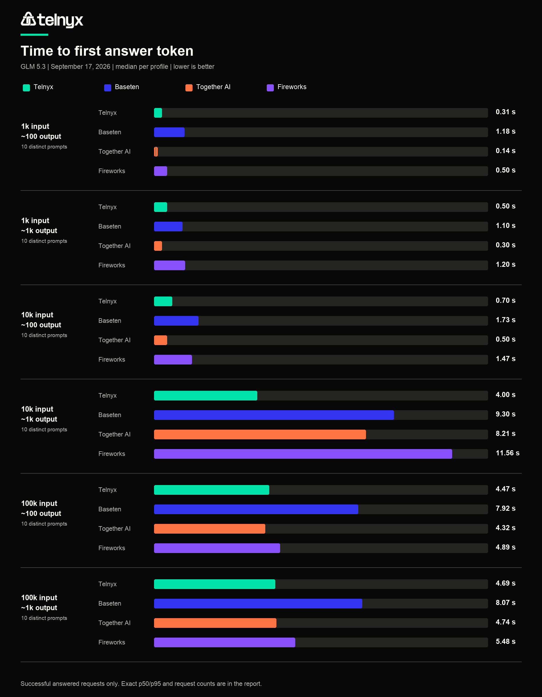
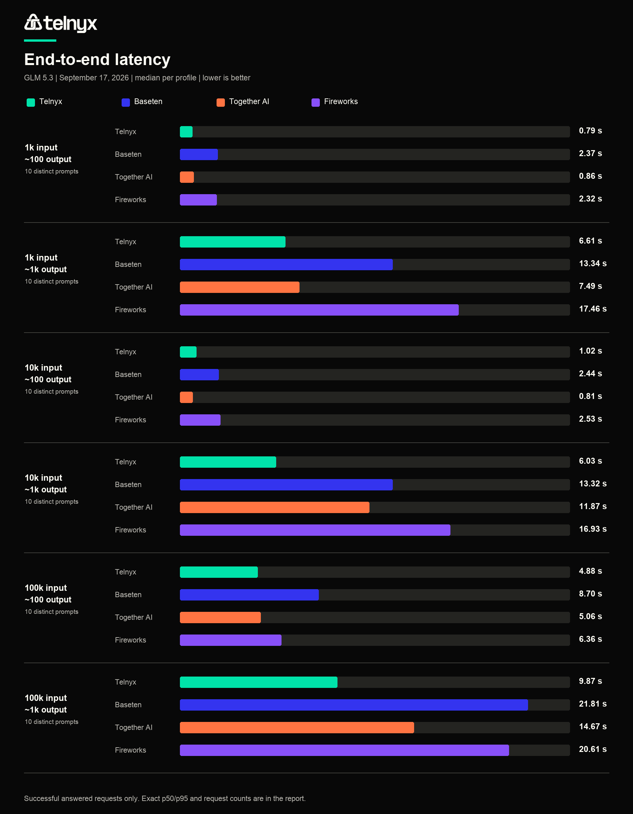
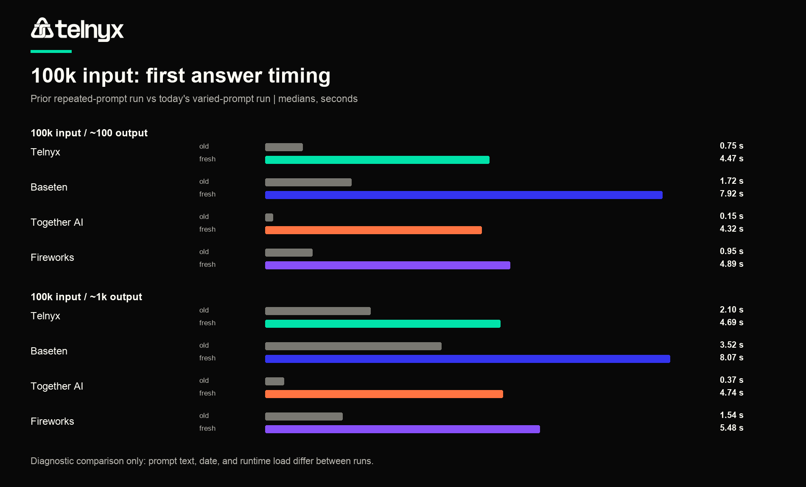

# LLM Inference Benchmarks

**GLM 5.3 fresh-prompt rerun**

**Run date:** September 17, 2026. **Scope:** Telnyx, Baseten, Together AI, and Fireworks. **Planned:** 240 requests (6 profiles x 10 distinct prompts x 4 providers).

**Answered requests:** 230/240. **Incomplete or failed requests:** 10/240. The latter are excluded from timing percentiles and listed separately below.

This run tests whether repeating exactly the same long prompt influenced the previous benchmark. We kept the six approximate input/output size profiles and used ten deterministic variants per profile, with the same variant sent to each provider. A distinct prefix and rearranged passage change the prompt from the start. This reduces exact-prefix reuse, but does **not** prove that any provider cache was enabled, disabled, or bypassed.

## At a Glance

| Profile | Lowest p50 TTFA | Lowest p50 E2E |
|---|---|---|
| 1k input / ~100 output | Together AI (0.14 s) | Telnyx (0.79 s) |
| 1k input / ~1k output | Together AI (0.30 s) | Telnyx (6.61 s) |
| 10k input / ~100 output | Together AI (0.50 s) | Together AI (0.81 s) |
| 10k input / ~1k output | Telnyx (4.00 s) | Telnyx (6.03 s) |
| 100k input / ~100 output | Together AI (4.32 s) | Telnyx (4.88 s) |
| 100k input / ~1k output | Telnyx (4.69 s) | Telnyx (9.87 s) |

## Time to first answer token

TTFA starts when the request is sent and stops at the first non-whitespace answer-content delta; reasoning deltas alone do not stop the clock. Lower is better. This is the primary responsiveness measure for this reasoning-model comparison.

| Input / target output | Provider | Answered n | p50 TTFA (s) | p95 TTFA (s) | p50 prompt tokens | p50 output tokens |
|---|---|---:|---:|---:|---:|
| 1k input / ~100 output | Telnyx | 10/10 | 0.31 | 0.44 | 935 | 120 |
| 1k input / ~100 output | Baseten | 10/10 | 1.18 | 2.69 | 936 | 120 |
| 1k input / ~100 output | Together AI | 10/10 | 0.14 | 0.25 | 935 | 120 |
| 1k input / ~100 output | Fireworks | 10/10 | 0.50 | 1.89 | 935 | 120 |
| 1k input / ~1k output | Telnyx | 10/10 | 0.50 | 1.05 | 985 | 1200 |
| 1k input / ~1k output | Baseten | 10/10 | 1.10 | 1.37 | 986 | 1200 |
| 1k input / ~1k output | Together AI | 10/10 | 0.30 | 0.96 | 985 | 1200 |
| 1k input / ~1k output | Fireworks | 10/10 | 1.20 | 2.96 | 985 | 1200 |
| 10k input / ~100 output | Telnyx | 10/10 | 0.70 | 0.80 | 9473 | 104 |
| 10k input / ~100 output | Baseten | 10/10 | 1.73 | 2.88 | 9474 | 100 |
| 10k input / ~100 output | Together AI | 9/10 | 0.50 | 0.60 | 9473 | 101 |
| 10k input / ~100 output | Fireworks | 10/10 | 1.47 | 3.36 | 9473 | 115 |
| 10k input / ~1k output | Telnyx | 8/10 | 4.00 | 5.69 | 9524 | 1200 |
| 10k input / ~1k output | Baseten | 10/10 | 9.30 | 77.86 | 9525 | 1200 |
| 10k input / ~1k output | Together AI | 6/10 | 8.21 | 10.69 | 9524 | 1200 |
| 10k input / ~1k output | Fireworks | 9/10 | 11.56 | 14.80 | 9524 | 1200 |
| 100k input / ~100 output | Telnyx | 10/10 | 4.47 | 4.76 | 88727 | 120 |
| 100k input / ~100 output | Baseten | 10/10 | 7.92 | 13.88 | 88728 | 120 |
| 100k input / ~100 output | Together AI | 8/10 | 4.32 | 43.07 | 88727 | 120 |
| 100k input / ~100 output | Fireworks | 10/10 | 4.89 | 12.06 | 88727 | 120 |
| 100k input / ~1k output | Telnyx | 10/10 | 4.69 | 5.48 | 88766 | 1200 |
| 100k input / ~1k output | Baseten | 10/10 | 8.07 | 10.91 | 88767 | 1200 |
| 100k input / ~1k output | Together AI | 10/10 | 4.74 | 9.69 | 88766 | 1200 |
| 100k input / ~1k output | Fireworks | 10/10 | 5.48 | 10.02 | 88766 | 1200 |

## E2E latency

End-to-end (E2E) latency is elapsed time from request send to the final streamed response. Lower is better. Output-token counts are shown because generated length materially affects E2E.

| Input / target output | Provider | Answered n | p50 E2E (s) | p95 E2E (s) | p50 output tokens |
|---|---|---:|---:|---:|---:|
| 1k input / ~100 output | Telnyx | 10/10 | 0.79 | 1.30 | 120 |
| 1k input / ~100 output | Baseten | 10/10 | 2.37 | 3.80 | 120 |
| 1k input / ~100 output | Together AI | 10/10 | 0.86 | 1.37 | 120 |
| 1k input / ~100 output | Fireworks | 10/10 | 2.32 | 3.65 | 120 |
| 1k input / ~1k output | Telnyx | 10/10 | 6.61 | 8.03 | 1200 |
| 1k input / ~1k output | Baseten | 10/10 | 13.34 | 17.09 | 1200 |
| 1k input / ~1k output | Together AI | 10/10 | 7.49 | 51.40 | 1200 |
| 1k input / ~1k output | Fireworks | 10/10 | 17.46 | 22.54 | 1200 |
| 10k input / ~100 output | Telnyx | 10/10 | 1.02 | 1.19 | 104 |
| 10k input / ~100 output | Baseten | 10/10 | 2.44 | 4.76 | 100 |
| 10k input / ~100 output | Together AI | 9/10 | 0.81 | 3.75 | 101 |
| 10k input / ~100 output | Fireworks | 10/10 | 2.53 | 4.60 | 115 |
| 10k input / ~1k output | Telnyx | 8/10 | 6.03 | 11.17 | 1200 |
| 10k input / ~1k output | Baseten | 10/10 | 13.32 | 104.03 | 1200 |
| 10k input / ~1k output | Together AI | 6/10 | 11.87 | 13.86 | 1200 |
| 10k input / ~1k output | Fireworks | 9/10 | 16.93 | 18.09 | 1200 |
| 100k input / ~100 output | Telnyx | 10/10 | 4.88 | 5.09 | 120 |
| 100k input / ~100 output | Baseten | 10/10 | 8.70 | 14.65 | 120 |
| 100k input / ~100 output | Together AI | 8/10 | 5.06 | 43.91 | 120 |
| 100k input / ~100 output | Fireworks | 10/10 | 6.36 | 13.56 | 120 |
| 100k input / ~1k output | Telnyx | 10/10 | 9.87 | 12.80 | 1200 |
| 100k input / ~1k output | Baseten | 10/10 | 21.81 | 23.18 | 1200 |
| 100k input / ~1k output | Together AI | 10/10 | 14.67 | 69.64 | 1200 |
| 100k input / ~1k output | Fireworks | 10/10 | 20.61 | 26.84 | 1200 |

## 100k Prompt Diagnostic

The September 16 run repeated identical prompts; this run varied them. The chart compares observed median TTFA, not a controlled A/B isolation of caching: day, load, prompt text, and possibly service behavior also changed. Do not attribute a difference solely to cache.

| Profile | Provider | Prior repeated p50 TTFA (s) | Fresh p50 TTFA (s) | Fresh p95 TTFA (s) |
|---|---|---:|---:|---:|
| 100k input / ~100 output | Telnyx | 0.75 | 4.47 | 4.76 |
| 100k input / ~100 output | Baseten | 1.72 | 7.92 | 13.88 |
| 100k input / ~100 output | Together AI | 0.15 | 4.32 | 43.07 |
| 100k input / ~100 output | Fireworks | 0.95 | 4.89 | 12.06 |
| 100k input / ~1k output | Telnyx | 2.10 | 4.69 | 5.48 |
| 100k input / ~1k output | Baseten | 3.52 | 8.07 | 10.91 |
| 100k input / ~1k output | Together AI | 0.37 | 4.74 | 9.69 |
| 100k input / ~1k output | Fireworks | 1.54 | 5.48 | 10.02 |

## Stream Behavior

The request asked every provider for `reasoning_effort=high`, but the API streams did not necessarily expose reasoning in the same way. These counts describe what the benchmark actually received, not the model's hidden work. The internal audit export retained literal reasoning and answer text; the public dataset retains the measured stream type, timing and token counts without publishing hidden reasoning traces.

| Provider | Answered n | First delta: reasoning | First delta: content | First delta: mixed | Rows with reasoning text | p50 reasoning chars |
|---|---:|---:|---:|---:|---:|---:|
| Telnyx | 58 | 37 | 21 | 0 | 37 | 117 |
| Baseten | 60 | 43 | 17 | 0 | 43 | 173 |
| Together AI | 53 | 35 | 18 | 0 | 35 | 134 |
| Fireworks | 59 | 38 | 21 | 0 | 38 | 130 |

## TTFT

TTFT is time to the first non-empty stream delta, which may be reasoning rather than answer text. It should not be read as time to the first visible answer; use TTFA for that.

| Profile | Provider | p50 TTFT (s) | p95 TTFT (s) |
|---|---|---:|---:|
| 1k input / ~100 output | Telnyx | 0.31 | 0.44 |
| 1k input / ~100 output | Baseten | 1.18 | 2.69 |
| 1k input / ~100 output | Together AI | 0.14 | 0.25 |
| 1k input / ~100 output | Fireworks | 0.50 | 1.89 |
| 1k input / ~1k output | Telnyx | 0.36 | 0.93 |
| 1k input / ~1k output | Baseten | 0.66 | 0.96 |
| 1k input / ~1k output | Together AI | 0.11 | 0.20 |
| 1k input / ~1k output | Fireworks | 0.67 | 2.51 |
| 10k input / ~100 output | Telnyx | 0.66 | 0.75 |
| 10k input / ~100 output | Baseten | 1.58 | 2.68 |
| 10k input / ~100 output | Together AI | 0.44 | 0.45 |
| 10k input / ~100 output | Fireworks | 1.38 | 2.83 |
| 10k input / ~1k output | Telnyx | 0.75 | 0.82 |
| 10k input / ~1k output | Baseten | 1.53 | 1.91 |
| 10k input / ~1k output | Together AI | 0.51 | 0.72 |
| 10k input / ~1k output | Fireworks | 1.30 | 2.26 |
| 100k input / ~100 output | Telnyx | 4.46 | 4.62 |
| 100k input / ~100 output | Baseten | 7.44 | 13.45 |
| 100k input / ~100 output | Together AI | 4.32 | 43.07 |
| 100k input / ~100 output | Fireworks | 4.89 | 12.06 |
| 100k input / ~1k output | Telnyx | 4.56 | 4.94 |
| 100k input / ~1k output | Baseten | 7.00 | 9.97 |
| 100k input / ~1k output | Together AI | 4.38 | 5.98 |
| 100k input / ~1k output | Fireworks | 4.59 | 9.00 |

## Throughput

These are approximate observed output-token rates, calculated from provider-reported output tokens divided by elapsed time after the first stream delta. They are not a concurrency or capacity measurement. For non-stream usage probes, the token count came from a separate call and may not exactly match the streamed output; treat cross-provider differences cautiously.

| Profile | Provider | Rate n | p50 output tokens/s | Usage source counts |
|---|---|---:|---:|---|
| 1k input / ~100 output | Telnyx | 10/10 | 248.5 | nonstream_probe: 10 |
| 1k input / ~100 output | Baseten | 10/10 | 106.5 | stream: 10 |
| 1k input / ~100 output | Together AI | 10/10 | 159.5 | stream: 10 |
| 1k input / ~100 output | Fireworks | 10/10 | 73.6 | stream: 10 |
| 1k input / ~1k output | Telnyx | 10/10 | 191.7 | nonstream_probe: 10 |
| 1k input / ~1k output | Baseten | 10/10 | 93.8 | stream: 10 |
| 1k input / ~1k output | Together AI | 10/10 | 162.8 | stream: 10 |
| 1k input / ~1k output | Fireworks | 10/10 | 73.2 | stream: 10 |
| 10k input / ~100 output | Telnyx | 10/10 | 257.2 | nonstream_probe: 10 |
| 10k input / ~100 output | Baseten | 10/10 | 97.5 | stream: 10 |
| 10k input / ~100 output | Together AI | 9/10 | 225.0 | stream: 9 |
| 10k input / ~100 output | Fireworks | 10/10 | 88.6 | stream: 10 |
| 10k input / ~1k output | Telnyx | 8/10 | 230.5 | nonstream_probe: 8 |
| 10k input / ~1k output | Baseten | 10/10 | 102.6 | stream: 10 |
| 10k input / ~1k output | Together AI | 6/10 | 106.5 | stream: 6 |
| 10k input / ~1k output | Fireworks | 9/10 | 76.8 | stream: 9 |
| 100k input / ~100 output | Telnyx | 10/10 | 268.7 | nonstream_probe: 10 |
| 100k input / ~100 output | Baseten | 10/10 | 94.1 | stream: 10 |
| 100k input / ~100 output | Together AI | 8/10 | 178.2 | stream: 8 |
| 100k input / ~100 output | Fireworks | 10/10 | 81.4 | stream: 10 |
| 100k input / ~1k output | Telnyx | 10/10 | 232.7 | nonstream_probe: 10 |
| 100k input / ~1k output | Baseten | 10/10 | 84.9 | stream: 10 |
| 100k input / ~1k output | Together AI | 10/10 | 121.1 | stream: 10 |
| 100k input / ~1k output | Fireworks | 10/10 | 76.1 | stream: 10 |

## Methodology

| Provider | API base | Model ID |
|---|---|---|
| Telnyx | `https://api.telnyx.com/v2/ai/openai` | `zai-org/GLM-5.3` |
| Baseten | `https://inference.baseten.co/v1` | `zai-org/GLM-5.3` |
| Together AI | `https://api.together.xyz/v1` | `zai-org/GLM-5.3` |
| Fireworks | `https://api.fireworks.ai/inference/v1` | `accounts/fireworks/models/glm-5p3` |

- Requests originated from the Telnyx stateful benchmark actor invoked through its `us-east-2` regional URL. Each provider request then went to that provider's configured public API endpoint; the actor was the common request origin. This does not imply Telnyx inference was served in the actor's region.
- The local controller used a pinned IP for the actor hostname because local DNS was unavailable. TLS still verified the regional hostname. The IP pin applied only to start/poll/export control calls, not to actor-to-provider benchmark traffic.
- All four providers received the same 60 prompt variants, each once. The six profiles target approximately 1k, 10k, and 100k input and ~100 or ~1k output. Actual provider-reported token counts appear in the tables; targets are not exact token counts.
- The actor sent `reasoning_effort=high` to each provider. This is the requested setting, not proof that providers execute equivalent reasoning workloads. The per-request CSV retains the status of that parameter.
- All calls streamed. TTFT is first non-empty stream delta (which can be reasoning); TTFA is first non-whitespace answer-content delta. E2E ends at stream completion. For a user-visible answer, TTFA is more meaningful than raw TTFT here.
- Runs were sequential by profile with one request at a time (`batchSize=1`), not a concurrency or peak-TPS test. Within each profile the actor ran ten Telnyx variants, then ten Baseten, then Together AI, then Fireworks. Provider order was not rotated, so time-varying load is a possible confounder. This is one day's observational measurement, not an availability or SLA study.
- Token usage and throughput may be based on a non-streaming usage probe if usage was absent from the stream. Do not compare throughput without checking `token_usage_source` and whether the probe returned a usable output-token count.
- p50 is the median and p95 uses linear interpolation over answered requests within each provider/profile. A row counts as answered only with an HTTP-success flag, non-empty answer content, TTFA, and E2E.

## Data and Reproduction

- [Request measurements](../data/measurements.csv)
- [First-delta diagnostic](../data/first-delta-diagnostic.csv)
- [Prompt manifest with hashes and seeds](../config/prompt-manifest.json)
- [Prompt fixtures](../config/fixtures/)
- [Benchmark runner](../scripts/run_glm53_fresh_prompt_actor_benchmark.py)

## Excluded Requests

| Provider | Prompt | Status | Error |
|---|---|---|---|
| Together AI | 03_10k_in_100_out_fresh_05 | 500 | provider error |
| Telnyx | 04_10k_in_1k_out_fresh_05 | 200 | missing answer/timing |
| Telnyx | 04_10k_in_1k_out_fresh_06 | 200 | missing answer/timing |
| Together AI | 04_10k_in_1k_out_fresh_01 | 200 | missing answer/timing |
| Together AI | 04_10k_in_1k_out_fresh_08 | 402 | benchmark account credit limit |
| Together AI | 04_10k_in_1k_out_fresh_09 | 402 | benchmark account credit limit |
| Together AI | 04_10k_in_1k_out_fresh_10 | 402 | benchmark account credit limit |
| Fireworks | 04_10k_in_1k_out_fresh_03 | 200 | missing answer/timing |
| Together AI | 05_100k_in_100_out_fresh_01 | 503 | provider unavailable |
| Together AI | 05_100k_in_100_out_fresh_02 | 402 | benchmark account credit limit |
